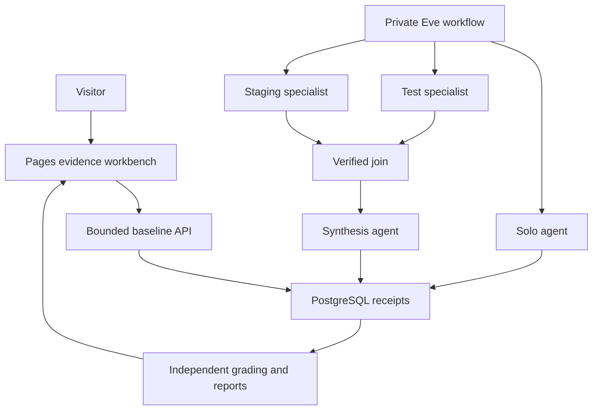

# crewbench

Does a fixed split review improve on a solo tool-using agent under the same aggregate resource limits?

[Open the evidence site](https://mekala27-45.github.io/crewbench/) · [Recorded report](https://mekala27-45.github.io/crewbench/data/report.json) · [API deployment](https://crewbench-api.vercel.app)

The evidence site is published. The qualified CPU model, execution inputs and 103 independently checked analysis inputs are frozen. [The 24-trial paired evaluation](https://github.com/mekala27-45/crewbench/actions/runs/42118015947) is in progress; no held-out success rate is claimed before its report is verified. The native API package passed isolated database acceptance, but hosted database binding, public access and a Vercel deployment cooldown still block live acceptance.

The fresh PostgreSQL baseline passed independent public-record grading on all 48 authored cases, including 24 held-out cases and the exact 12-case paired subset. This remains provisional until the private latent answer key is rechecked. Run 42117978561 verified 12 of 12 scripted recovery overlays with fresh independent post-action reads. API and browser run 42117828030 passed 21 API checks and 60 browser checks across 360, 768 and 1440 pixels, both themes and enlarged text. Review run 42121372456 reconciled 33 Node tests, 26 Python tests and all 28 native development responses, with 12 of 18 release requirements done. [Read every requirement and its evidence](RESULTS.md).

[Watch the recorded demonstration](https://github.com/mekala27-45/crewbench/raw/refs/heads/main/artifacts/demo/crewbench-demo.webm) · [Interview cards](docs/INTERVIEW-CARDS.md) · [Daily build log](docs/DAILY-BUILD-25.md)

The demonstration captures the public development checkpoint, including the explicit missing actual-result state. It does not claim a live API result.

## Architecture

The public API accepts fixed synthetic baseline cases only. The private worker uses a local CPU model, one active provider request and a fixed graph. Actual role tools can list evidence, read up to four canonical records and submit structured findings or assessments. They have no shell, arbitrary files, HTTP, deployment or model-directed delegation tools.

## Reproduce

Use Node 24.19.0 and Python 3. Run `npm ci`, `npm test` and `python3 -m unittest discover -s tests -p 'test_*.py'`. The lockfile pins every installed dependency.

For PostgreSQL checks, set `DATABASE_URL` to an isolated development database, then run `node scripts/migrate.ts`, `node scripts/baseline.ts --postgres` and `node scripts/recovery.ts`. Recovery refuses remote database hosts and creates its own test schema. `node src/api/server.ts`, `node scripts/check-api.ts` and `npx playwright test` exercise the live baseline flow and browser states.

The private latent answer key remains local. Public runtime evidence and prior independent baseline grades are available, but complete latent-truth regeneration requires those retained local files in a restored local workspace. The key and its generator remain private.

Execution is reproduced at source `d3d3a2e5a81cf6a0cd46e80b92fbf403b0ae2c92`. The review branch deliberately retains stricter analysis at `evaluation/analysis-freeze.json`. Run `node scripts/verify-shared-execution.ts` with read-only GitHub authentication before importing unchanged raw results; it checks 93 causal files and dispatch-control equivalence. Do not request another model run from this combined analysis tree.

Development and model-probe result branches retain failed runs. The freeze workflow verifies actual role provenance and the calibration artifact before preparing a reviewable request. The evaluation runner must match the exact freeze digest and registers all 24 planned method-case rows before inference. Failed and unexecuted rows remain in the denominator.

## Evidence and limits

- [Baseline and first actual runtime evidence](https://github.com/mekala27-45/crewbench/tree/results/development-42099764606/artifacts)
- [Verified scripted recovery](https://github.com/mekala27-45/crewbench/tree/results/recovery-42117978561/artifacts/recovery)
- [Responsive browser and API evidence](https://github.com/mekala27-45/crewbench/tree/results/web-42117828030/artifacts)
- [Native provider and submission-size calibration](https://github.com/mekala27-45/crewbench/tree/results/model-probe-42114717980/artifacts/probes)
- [Qualified actual development](https://github.com/mekala27-45/crewbench/tree/results/development-42115848494/artifacts/development)
- [Execution freeze](evaluation/freeze.json), [independent analysis freeze](evaluation/analysis-freeze.json) and [native package acceptance](https://github.com/mekala27-45/crewbench/tree/results/host-42116306332/artifacts/host)
- [Decisions](DECISIONS.md), [retained failures](DEAD-ENDS.md), [operating notes](docs/OPERATIONS.md) and [limitations](docs/LIMITATIONS.md)

The 1.7B candidate produced invalid references and omitted fields. The explicit 4B instruction-only candidate is now pinned by native artifact and template hashes. Run 42109940250 produced bare JSON instead of native submission tool calls, so all four trials failed. Run 42115848494 then accepted both solo assessments and a complete specialist-plus-synthesis flow, with all 28 native requests reconciled. The other split development trial failed to submit and is retained. Those are actual failures, not successful model assessments. The calibration probe found the largest representative development submissions fit within the 512-token output ceiling: 191 tokens for solo and synthesis, 102 for the test specialist and 106 for the staging specialist.

Fixed partitions, context construction and role prompts differ as well as agent count. The experiment cannot isolate agent count alone, establish general superiority or measure production release quality. Inference is serialized, so no parallel speedup is claimed. The registered utility floor is 8 of 12 strict successes per method with no accepted unsupported ready verdict. It is not forced to pass.

Portfolio experiment on authored synthetic release evidence. No production release is assessed or changed. Actual model runs, deterministic decisions and scripted runtime tests are reported separately. Results apply only to the declared cases, model, budgets and execution environment.
